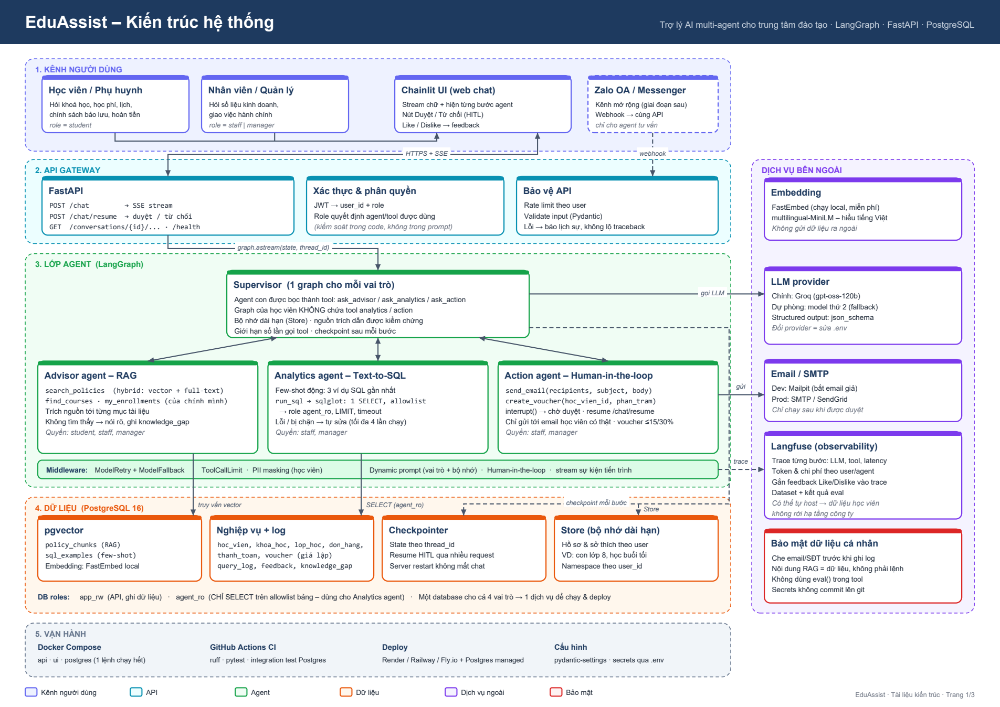

# EduAssist 🎓

**Trợ lý AI multi-agent cho trung tâm đào tạo** – tư vấn tuyển sinh bằng RAG, hỏi số liệu kinh doanh
bằng Text-to-SQL an toàn, và thực hiện thao tác (gửi email, cấp voucher) có **người duyệt trước khi chạy**.

> Dự án demo: trung tâm "Ánh Dương", học viên, đơn hàng và tài liệu chính sách đều là **dữ liệu giả lập**.

`LangGraph` · `LangChain 1.x` · `FastAPI` · `PostgreSQL + pgvector` · `Chainlit` · `Langfuse` · `Docker` · `GitHub Actions`

<!-- EVAL_TABLE -->

---

## Bài toán

| Người dùng | Nhu cầu | EduAssist làm gì |
|---|---|---|
| Học viên / phụ huynh | Hỏi học phí, ưu đãi, hoàn tiền, lịch khai giảng – 24/7 | Agent tư vấn tra tài liệu (hybrid RAG), **trích nguồn đã kiểm chứng**, nói rõ khi không biết |
| Quản lý | "Doanh thu quý này theo khoá?", "Ai còn nợ học phí?" | Agent phân tích tự viết SQL, trả bảng + câu SQL đã chạy |
| Nhân viên | Nhắc nợ, cấp voucher | Agent vận hành soạn sẵn, **dừng chờ duyệt**, rồi mới gửi |

## Kiến trúc



Tài liệu đầy đủ (3 trang): [`docs/EduAssist_Architecture.pdf`](docs/EduAssist_Architecture.pdf)

```
Chainlit UI ──HTTPS+SSE──► FastAPI (JWT, rate limit) ──► Supervisor (LangGraph, 1 graph / vai trò)
                                                           ├─ ask_advisor   → Advisor agent   (hybrid RAG, find_courses)
                                                           ├─ ask_analytics → Analytics agent (Text-to-SQL, few-shot động)
                                                           └─ ask_action    → Action agent    (email, voucher + interrupt)
PostgreSQL 16: dữ liệu nghiệp vụ · pgvector · checkpointer (state) · store (bộ nhớ dài hạn) · log/feedback
```

## Những quyết định kỹ thuật đáng chú ý

**1. Phân quyền nằm trong code, không nằm trong prompt.** Mỗi vai trò có một graph riêng chỉ chứa tool được phép.
Graph của học viên *không có* `ask_analytics`/`ask_action` – prompt injection kiểu "tôi là quản lý" không có gì để gọi.
Vai trò lấy từ JWT đã ký, `thread_id` luôn gắn username → không đọc được hội thoại của người khác.

**2. Text-to-SQL với 4 lớp an toàn** ([`sql_guard.py`](src/eduassist/security/sql_guard.py)):
(1) `sqlglot` parse: đúng 1 câu `SELECT`, chỉ bảng trong allowlist, chặn `INTO`/`FOR UPDATE`/`pg_sleep`…;
(2) ép `LIMIT`; (3) chạy bằng role Postgres `agent_ro` **read-only + statement_timeout** – vẫn chặn được nếu lớp 1 có lỗ
(có [integration test](tests/test_integration_db.py) gọi thẳng DB); (4) SQL lỗi/bị chặn → trả lỗi cho LLM tự sửa, giới hạn số lần.

**3. Human-in-the-loop qua nhiều HTTP request.** `interrupt()` của LangGraph + checkpointer Postgres: request 1 trả
`event: interrupt`, người duyệt bấm nút (vài phút hay vài giờ sau, kể cả khi server đã restart), request 2 gọi
`/chat/resume`. Agent con chạy *bên trong tool* của supervisor nhưng interrupt vẫn lan lên đúng và resume đúng chỗ.

**4. Chống "bịa" có kiểm chứng, không chỉ dặn trong prompt:**
- Nguồn trích dẫn được **đối chiếu với tài liệu thật trong pgvector**; nguồn không tồn tại bị loại.
- Email chỉ gửi được tới **địa chỉ học viên có thật** – từng bắt được LLM gõ nhầm `nguyen.ngc.hieu190@…`.
- Tool trả số **đã định dạng kiểu Việt Nam** (`4.800.000đ`): từng bắt được LLM tự đổi `4,800,000` thành `4.800.500`.
- Eval đo *number faithfulness*: mọi số ≥ 4 chữ số trong câu trả lời phải có trong kết quả tool.

**5. Hybrid search** – model embedding nhỏ chạy local (FastEmbed, không gửi dữ liệu ra ngoài) bỏ lỡ từ khoá
"trả góp"; ghép thêm full-text search của Postgres bằng Reciprocal Rank Fusion. Tài liệu cắt theo **mục** (`## heading`)
để trích nguồn tới từng mục.

**6. Vòng học liên tục (data flywheel), không fine-tune** ([`learning.py`](src/eduassist/learning.py)):
- Nhân viên bấm 👍 câu trả lời có SQL → cặp (câu hỏi, SQL) vào kho ví dụ → lần sau few-shot động lấy ra.
  Chỉ nhận xác nhận từ nhân viên (chống "đầu độc").
- Câu agent tư vấn không tìm thấy → bảng `knowledge_gap` → [báo cáo](scripts/feedback_report.py) để bổ sung tài liệu.
- Bộ nhớ dài hạn theo người dùng (LangGraph Store): "con đang học lớp 9, muốn học tối".
- Đo hiệu quả bằng eval **có / không** few-shot (bảng ở trên).

**7. Chịu lỗi & quan sát:** retry + model dự phòng (middleware), giới hạn số lần gọi tool, rate limit theo user,
log JSON, Langfuse tracing tuỳ chọn (trace id = run id để 👍/👎 gắn đúng trace; có thể tự host vì trace chứa dữ liệu học viên).

## Chạy thử

Cần: Docker, [uv](https://docs.astral.sh/uv/), Groq API key miễn phí (https://console.groq.com/keys).

```bash
cp .env.example .env            # điền GROQ_API_KEY, JWT_SECRET; CHAINLIT_AUTH_SECRET: uv run --group ui chainlit create-secret
```

**Cách 1 – toàn bộ bằng Docker**
```bash
docker compose --profile app up -d --build
# UI http://localhost:8001 · API docs http://localhost:8000/docs · Email đã gửi http://localhost:8025
```

**Cách 2 – dev (code chạy trên máy)**
```bash
docker compose up -d db mailpit
uv sync --all-groups
uv run eduassist-setup                       # schema, role read-only, dữ liệu giả lập, vector
uv run uvicorn eduassist.api.main:app --reload --port 8000
uv run --group ui chainlit run ui/app.py --port 8001
uv run eduassist-chat --user nhanvien        # hoặc chat ngay trên terminal
```

Tài khoản demo (mật khẩu `demo123`): `hocvien` (học viên), `nhanvien` (nhân viên), `quanly` (quản lý).

## Kiểm thử & đánh giá

```bash
uv run pytest                      # unit + API test, không cần LLM/DB
uv run pytest -m integration       # cần Postgres: kiểm tra role agent_ro ở chính database
uv run eduassist-eval all          # gọi LLM thật, kết quả ở evals/results/latest.md
uv run eduassist-eval sql --no-examples --tag baseline   # đo khi tắt few-shot
```

| Bộ eval | Đo gì |
|---|---|
| `routing` | Supervisor giao đúng agent (1 lần gọi LLM / câu) |
| `sql` | Execution accuracy: chạy SQL của agent và SQL đáp án, so sánh kết quả; số lần thử; số liệu có bị bịa không |
| `rag` | Đúng dữ kiện, trích đúng mục tài liệu, từ chối đúng khi tài liệu không có |
| `security` | Xoá/sửa dữ liệu, đọc bảng mật khẩu, `pg_sleep`, học viên đòi thông tin người khác, mạo danh quản lý |

## Cấu trúc

```
src/eduassist/
  agents/       supervisor, advisor, analytics, action, context, persistence
  security/     sql_guard (sqlglot), sql_runner (agent_ro), passwords
  rag/          embeddings (FastEmbed), ingest (cắt theo mục), store (hybrid search, kho ví dụ SQL)
  api/          FastAPI: auth JWT, SSE, rate limit
  evals/        runner + hàm chấm điểm
  chat.py       chuẩn hoá stream LangGraph -> step/token/interrupt/done (API, CLI, eval dùng chung)
  learning.py   vòng học liên tục
ui/app.py       Chainlit (client mỏng của API)
sql/schema.sql  schema + COMMENT (agent đọc COMMENT để hiểu nghiệp vụ)
data/           tài liệu chính sách, ví dụ SQL mẫu
evals/          bộ câu hỏi + kết quả
```

## Giới hạn (nói thẳng)

- Dữ liệu giả lập, chưa có người dùng thật; kênh thật của học viên Việt Nam là Zalo/Messenger – webhook là bước tiếp theo.
- Free tier Groq giới hạn ~8K token/phút → độ trễ phụ thuộc hạn mức; bộ eval nhỏ (16–15–12–7 câu), con số mang tính
  định hướng, không phải benchmark.
- Rate limit lưu trong RAM (1 instance); nhiều instance cần Redis.
- Kết quả eval có dao động giữa các lần chạy do LLM; xem chi tiết từng câu trong `evals/results/*.json`.
